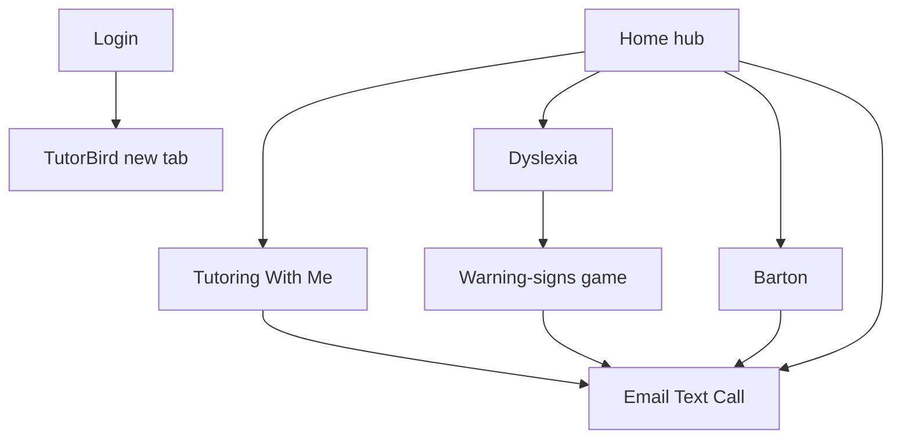

# Trapp Tutoring — project plan

Actionable plan for the redesign. This file is documentation only. It does not include site code, logo drafts, or a running app.

**Decision record:** [CONTEXT-MASTER.md](CONTEXT-MASTER.md)  
**Current-copy record:** [CONTENT-INVENTORY.md](CONTENT-INVENTORY.md)  
**Interview log:** [INTERVIEW-AND-GAPS.md](INTERVIEW-AND-GAPS.md)  
**Ticket list:** [BACKLOG.md](BACKLOG.md)

If a later page draft conflicts with these files, treat [CONTEXT-MASTER.md](CONTEXT-MASTER.md) as the decision record and [CONTENT-INVENTORY.md](CONTENT-INVENTORY.md) as the current-copy record. Do not invent new factual claims about Erin, Barton, or the offer.

---

## 1. Leftovers locked in this plan

These were open in [INTERVIEW-AND-GAPS.md](INTERVIEW-AND-GAPS.md) and are now decided.

| Topic | Decision |
| --- | --- |
| Platform | Leave Google Sites. Custom-coded site, local → GitHub → [trapptutoring.com](https://trapptutoring.com) |
| Mobile | Required. Usable at 320px, no horizontal scroll, tap-friendly meeting buttons |
| Stack | [Astro](https://astro.build/) + TypeScript + CSS custom properties. Small client islands for the warning-signs game and testimonial gallery. Hosting: GitHub-connected static host (Cloudflare Pages or GitHub Pages) + custom domain |
| Logo | Leave the book/flowers mark. Explore a **new** kid-friendly, calm symbol (letter-tile / word-building, and/or a simple monogram). Education + fun, not clinical |
| Palette | Teal / coral / cream. Not Reading Guru mint, not Air Reading red, cooler than crayon primaries |
| Photos | Shot list now. Labeled placeholders that name the recommended replacement image. Swap when Erin delivers |
| Student faces | Allowed (owner has permission). Classroom/session shots use the same labeled-placeholder pattern |
| Testimonials | Ship all 6. Gallery that shows 1–2 at a time. No autoplay |
| Waitlist | Omit until Erin asks |
| Program length | “It takes most students about two to three years to complete all ten levels, and the pace depends on the student.” |
| Resource URLs | Prefer [starting-site-links.txt](../starting-site-links.txt): Bright Solutions `https://dys-add.com/`; Barton scope `https://bartonreading.com/faqs/#scope`. HTTPS for the rest. Strip the Yale `gclid` tracker |
| Legal pages | None in v1 (no Privacy, Terms, or photo-release page) |
| Login | Thin page. Button opens TutorBird in a **new tab** and says it leaves this site |
| Bio | Only the three already-locked fact fixes: drop “licensed”; say Barton-trained; six years. No other About rewrite |

---

## 2. Information architecture

The sitemap is already locked. This section specifies **page sections**, nav behavior, and conversion — not a new tree.

```text
Home                Hub
Tutoring With Me    Offer + tech + eligibility
Dyslexia            Info + warning-signs game + resources
Barton              System + 10 levels + official links
Login               Thin hop to TutorBird
```

**Removed as pages:** About, Contact.  
**Not in v1:** site search, Privacy, Terms, photo-release.

**Footer:** branded wordmark only. Nav stays in the top header; Email / Text / Call stay in the meeting section. No legal links in v1.



### Nav

Air Reading **structure only:** logo left; text links Home · Tutoring With Me · Dyslexia · Barton · Login; filled **Set up a meeting** on the right.

- That filled action scrolls to the in-page meeting section. Never a modal.
- Current page gets the underline treatment.
- Links stay visible in the top header at every width (they wrap; not a Menu, not a pop-up).
- Do not copy Reading Guru’s long multi-row nav.

### Meeting pattern

Repeat on every content page (Home, Tutoring With Me, Dyslexia, Barton): large **Email**, **Text**, and **Call**.

- Email → `mailto:trapptutoring@gmail.com`
- Call → `tel:+16517600402`
- Text → `sms:+16517600402`

Copy direction (refine later, do not invent): inquire for a **free meeting** to see if Trapp Tutoring is a good fit.

### Home

1. **Hero** — Reading Guru *energy* only: large live-text headline, generous space, playful welcoming image (placeholder until Erin photo). Tagline as HTML, not inside a graphic: `Effective · Interactive · Research-based`.
2. **Short Erin intro** — current Home paragraph (Barton, online, interactive / safe / positive).
3. **About accordion** — full bio + philosophy from the inventory About page, plus the three fact fixes.
4. **Testimonial gallery** — all 6 quotes, 1–2 visible, prev/next, no autoplay.
5. **Meeting buttons**
6. **Paths** to Tutoring With Me, Dyslexia, and Barton — each labeled so a visitor knows what they will find.

### Tutoring With Me

Hero + meeting buttons; five icon facts (1:1, fully remote, interactive/multisensory + Koala Go, Barton system, 2–3×/week + ~50 minutes); tech list; **Who is this for?** (not “Who can tutor?”); repeat meeting buttons.

### Dyslexia

About-dyslexia lines (fix “Dyslexia Researches”); warning-signs game; Susan Barton attribution; six resource links; meeting buttons. This page currently has no CTA — add one.

### Barton

Intro; 10 level names (no per-level essays); official Barton links; meeting buttons. This page currently has no CTA — add one.

Duration sentence on this page (and anywhere program length is mentioned):

> It takes most students about two to three years to complete all ten levels, and the pace depends on the student.

### Login

One sentence from current copy (students working with Erin use this for scheduling and payments) + one button to `https://app.tutorbird.com/`. Open in a new tab. Visible text that it leaves this site / opens in a new tab.

---

## 3. Visual system

Rebuild everything except text and linked content. Take **layout/energy** from [readingguru.com](https://readingguru.com/) and **nav chrome** from [airreading.com](https://airreading.com/). Do not copy their colors, type, stock child, long nav, or pop-ups.

**Feel:** bright but cooler than crayon primaries; education + fun; simple; not chaotic; not a clinic. A child looking over a parent’s shoulder should see warmth.

### Palette (teal / coral / cream)

Tokens to spec and contrast-check in the design-system ticket before use:

- Cream page surface (not stark white)
- Deep teal ink for body and headings (aim 7:1 on cream)
- Mid teal for links and the nav underline
- Coral for the filled meeting action and playful accents — **not** for small body text if contrast fails; then use deep teal buttons with cream type
- White cards/wells
- Game feedback uses teal encouragement, not red-X scoring

### Type (dyslexia-first)

- One readable sans for UI and body (prefer Atkinson Hyperlegible or Lexend)
- Body about 18–20px, line-height 1.6–1.75, measure about 60–65ch, left-aligned
- No justified text, no long italics, no all-caps paragraphs
- Headings in the same family or a slightly friendlier sans — not script, not the current large serif as the system
- Tagline and wordmark as live text (or titled SVG), never essential words baked into a raster

### Components to design once

Top tabs + mobile disclosure; meeting trio; accordion; five offer-icon cards (rebuild, better sizing); testimonial gallery; resource list; Barton level list; footer; labeled image placeholders.

### Motion

- Subtle nav underline on hover / current page
- Accordion and gallery are instant under `prefers-reduced-motion`
- No autoplay video, no overlays, no chat widgets, no cookie walls

### Icons

One per offer fact: 1:1, fully remote, interactive/multisensory, Barton system, multiple times per week (~50 minutes). Same visual language as the new logo family.

---

## 4. Accessibility bar

Parents of students with dyslexia often have dyslexia themselves. This is a requirement, not a polish pass.

**Bar:** WCAG 2.2 **AA**, plus these extras:

- Skip link; visible focus; `:focus-visible` not `outline: none`
- Meaningful alt text; **no essential words in images**
- Keyboard for nav, accordion, gallery, and the game
- Touch targets ≥44px (WCAG 2.2 target size) on meeting buttons and game controls
- Color is never the only meaning in the game
- `prefers-reduced-motion`; no focus-stealing pop-ups
- Predictable headings and one purpose per page
- Usable at 320px width; no horizontal scroll; mobile meeting buttons always obvious
- **Narration / read-aloud is out of scope**

Verify with keyboard-only, a screen-reader spot-check, Lighthouse/axe, and a real phone pass before launch.

---

## 5. Warning-signs game

Flagship interactive on Dyslexia. Wording of the signs stays the Susan Barton lists in [CONTENT-INVENTORY.md](CONTENT-INVENTORY.md). Keep the attribution.

**Experience:** “Do I notice this in my student?”

1. Persistent **not a diagnosis** line
2. Choose age group: Preschool / Elementary / High School / Adulthood
3. Walk the list for that group. High School and Adulthood include earlier signs (current copy says “all previous plus”) — show those as a prior section the parent can include, not a hidden test
4. Each sign: **I notice this** / **Not sure** (or skip). Native controls, large targets
5. Progress and short encouragement — not a score, not red X’s
6. Result: keep “three or more → learn more” in spirit. Gentle message either way (“every child is different” / “these signs are worth learning more about”)
7. Next step: resources on the same page + meeting buttons

Session-only (no account, no email capture). Low-stress, readable, mobile-first. One sign at a time or a short stacked list — not a dense checkbox wall.

---

## 6. Logo

In scope for a later design conversation, ticketed in [BACKLOG.md](BACKLOG.md). Do not draw it in this docs step.

- New symbol; do not refresh the book/flowers mark
- Explore **letter-tile / word-building** and a **simple monogram** (2–3 options for Erin)
- Sit education + fun, kid-friendly, calm — not clinical, not chaotic
- Must work at favicon size and in the left nav
- SVG with an accessible title; wordmark “Trapp Tutoring” as live text or titled SVG
- Drawn in the teal / coral / cream system

---

## 7. Photo plan

Do not block layout or launch code on delivery. Every image slot is a labeled placeholder that states the **recommended replacement**.

### Shot list for Erin

1. **Hero / welcome** — Erin, warm, facing camera, space around her (not a generic child-at-laptop stock photo)
2. **About headshot** — different from the hero if possible
3. **Teaching setup** — her workspace / Koala Go, over-the-shoulder or at the desk
4. **Session photo** — student faces allowed with permission
5. **Optional close-up** — letter tiles / games (no third-party logos we cannot use)

Existing Home/About Erin photos are fallbacks only if she wants them; this plan assumes placeholders first. Do not ship the current About Koala screenshots as-is (they are product captures, not the new art direction) unless she later chooses one as a replacement.

---

## 8. Light-edit copy list

The redesign is visual, structural, and interactive — not a content rewrite. Use inventory wording except:

- Typos: “Dyslexia Researches”, “and average”, “each students”, “Chrome books”, “listenting”, “everyday of preschool”, missing period after “generous Erin”
- “Who can tutor?” → “Who is this for?”
- “licensed K-12 teacher” → “K-12 teacher”; “four years” → “six”; never “Barton-certified”
- Duration unified to the two-to-three-years sentence in §2
- URLs per [starting-site-links.txt](../starting-site-links.txt); HTTPS; Yale without `gclid`
- Testimonials: keep all 6, including ESL/preschool; gallery on Home (and can repeat near the About accordion)

---

## 9. Implementation phases

This docs step is complete once the plan and backlog exist. Later conversations execute in this order:

| Phase | Name | Outcome |
| --- | --- | --- |
| 1 | Foundation | GitHub repo, Astro + TS, tokens, type, skip link, responsive shell, mobile disclosure nav, meeting-button component |
| 2 | Brand | 2–3 logo options; rebuilt offer icons; placeholder image component |
| 3 | Chrome + Home | Top tabs, footer, hero, About accordion, testimonial gallery, paths, meeting section |
| 4 | Content pages | Tutoring With Me, Barton, and Login from inventory + light edits |
| 5 | Dyslexia + game | Flagship interactive, attribution, resources, CTA |
| 6 | Photos + QA | Swap placeholders, keyboard / screen-reader / phone, axe, reduced-motion |
| 7 | Launch | Deploy from GitHub to trapptutoring.com; cut over from Google Sites |

Tickets live in [BACKLOG.md](BACKLOG.md).
